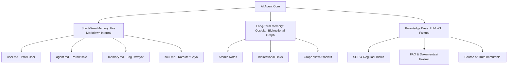

# 💡 Agent Memory Architecture (Arsitektur Memori Agent)

> [!info] Definisi
> **Agent Memory Architecture** adalah struktur multi-lapis yang digunakan AI Agent untuk menyimpan profil, preferensi pengguna, rekam jejak tugas masa lalu, dan referensi faktual permanen agar terhindar dari batas jendela konteks (*context window limit*) serta kehilangan memori antarsesi.

## 🧠 Tiga Lapisan Memori

### 1. Short-Term Memory (Memori Internal Bawaan)
Di dalam framework seperti [[wiki/entities/hermes-agent|Hermes]], setiap agent memiliki 4 berkas Markdown otomatis:
- `user.md`: Menampung profil pengguna, gaya kerja, dan preferensi komunikasi.
- `agent.md`: Menjelaskan scope peran kerja spesifik agent (misal: Finance Agent).
- `memory.md`: Log tugas yang baru saja dikerjakan atau instruksi berjalan.
- `soul.md`: Persona, tone suara, dan karakter inti agent.
*Batasan*: Jika data di `memory.md` terlalu besar, model AI dapat mengalami bias atau kelebihan konteks (*context bloat*).

### 2. Long-Term Memory ([[wiki/entities/obsidian|Obsidian]])
Untuk memori jangka panjang, catatan dipecah menjadi file-file kecil (*atomic notes*) di Obsidian dengan fitur:
- **Bidirectional Linking (`[[...]]`)**: Menghubungkan pengalaman kerja lampau (misal: log meeting klien) dengan proyek terkait.
- **Graph View**: Memungkinkan agen menelusuri asosiasi pikiran dan melihat hubungan antardokumen secara grafis.

### 3. Knowledge vs Memory (Konsep LLM Wiki Karpathy)
> [!tip] Perbedaan Kunci
> - **Memory**: Berisi *pengalaman* subjektif dan riwayat interaksi agent (apa yang pernah dikerjakan kemarin).
> - **Knowledge (LLM Wiki)**: Berisi *referensi faktual* objektif atau *source of truth* permanen (SOP, regulasi perusahaan, data spesifikasi produk).

## 🧩 Hubungan dengan Konsep Lain
- Menjaga fokus dalam: [[wiki/concepts/multi-agent-system]] — mencegah kebocoran konteks antar-agent.
- Menjadi pondasi bagi: [[wiki/concepts/skill-as-sop]] — skill merujuk pada aturan yang tersimpan di memori dan knowledge.
- Dibackup otomatis ke: GitHub secara terjadwal untuk menjamin persistensi data.

## 📚 Sumber yang Membahas Konsep Ini
- [[wiki/sources/video-2-hermes-dashboard-telegram-memori]] — Pembahasan berkas `soul.md`, `memory.md`, `agent.md`, `user.md`.
- [[wiki/sources/video-4-struktur-ai-team-dan-arsitektur]] — Integrasi Obsidian, LLM Wiki Karpathy, dan pemisahan Memory vs Knowledge.
