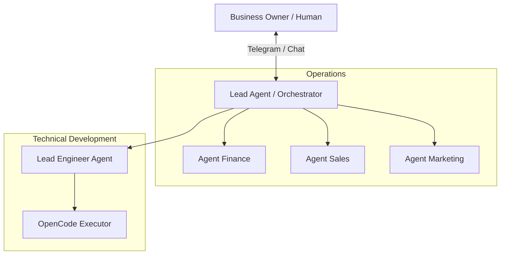

# 💡 Multi-Agent System (Sistem Multi-Agent)

> [!info] Definisi
> **Multi-Agent System (MAS)** dalam konteks tim AI bisnis adalah arsitektur di mana berbagai profil agent dikonfigurasikan dengan peran (*role*), ruang kerja (*workspace*), keterampilan (*skill*), dan memori terpisah untuk menangani divisi yang berbeda (seperti Finance, Sales, Marketing, dan Engineering) di bawah koordinasi **Lead Agent**.

## 🔍 Mengapa Satu Profil Agent Tidak Cukup?
Ketika seorang pebisnis mencoba menjejalkan semua pekerjaan bisnis ke dalam satu profil agent:
1. **Context Pollution**: Jendela konteks prompt dipenuhi instruksi yang saling tumpang-tindih (misal: aturan laporan keuangan bercampur dengan gaya penulisan caption media sosial).
2. **Penurunan Akurasi**: Agent menjadi rentan bingung (*confused*) dan menghasilkan halusinasi.
3. **Risiko Keamanan**: Agent penjualan bisa secara tidak sengaja mengakses atau mengubah spreadsheet pembukuan internal.

## 👥 Struktur Peran dalam Tim AI

### 1. Peran Kunci Lead Agent
- **Kanal Komunikasi Tunggal**: Menjadi titik kontak utama bagi business owner (biasanya via Home Channel Telegram).
- **Delegasi Cerdas**: Memecah instruksi besar pemilik bisnis menjadi sub-tugas untuk agent divisi yang tepat.
- **Onboarding Agent Baru**: Layaknya divisi HR, Lead Agent memperkenalkan agent baru pada lingkungan sistem, struktur folder Google Drive, dan SOP kerja.
- **Troubleshooting**: Membantu memperbaiki konfigurasi atau dependensi saat sub-agent mengalami kegagalan.

### 2. Hierarki Pengembangan Software (Kasus Video 5)
- **Business Owner**: Menentukan visi, masalah, dan kebutuhan bisnis.
- **Lead Agent**: Menyusun rangkuman tujuan dan mendelegasikan ke divisi teknis.
- **Lead Engineer Agent**: Membuat *product specification*, *implementation plan*, dan melakukan review hasil coding.
- **[[wiki/entities/opencode|OpenCode]]**: Mengeksekusi penulisan kode, menjalankan dev server, testing unit, dan memperbaiki bug (*self-healing code loop*).

## 🧩 Hubungan dengan Konsep Lain
- Membutuhkan: [[wiki/concepts/sandbox-security]] — setiap agent memiliki folder terisolasi di Google Drive.
- Memerlukan: [[wiki/concepts/skill-as-sop]] — setiap agent dibekali SOP tugas masing-masing.
- Dipantau oleh: [[wiki/concepts/mission-control]] — melihat visualisasi status interaksi antar-agent secara transparan.

## 📚 Sumber yang Membahas Konsep Ini
- [[wiki/sources/video-4-struktur-ai-team-dan-arsitektur]] — Mengapa butuh banyak agent, pemilihan model per-peran, dan fungsi Lead Agent.
- [[wiki/sources/video-5-membangun-mission-control-ai-team]] — Pola kolaborasi Lead Agent, Lead Engineer, dan OpenCode.
